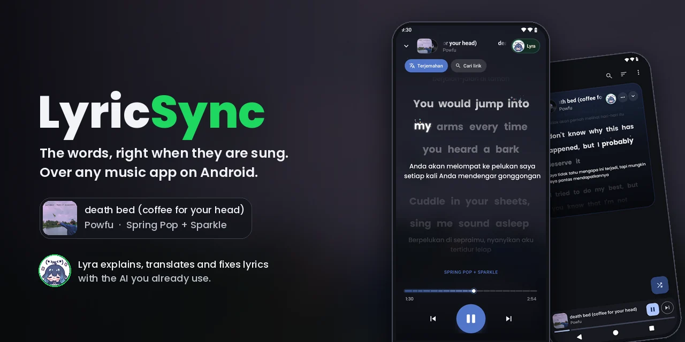
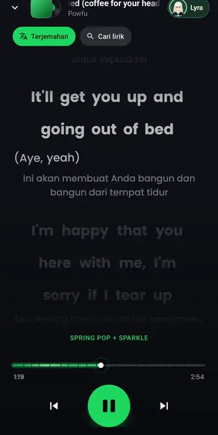
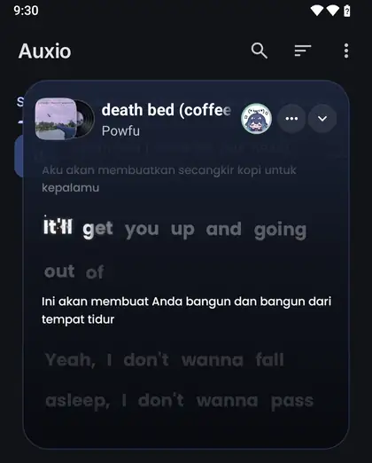
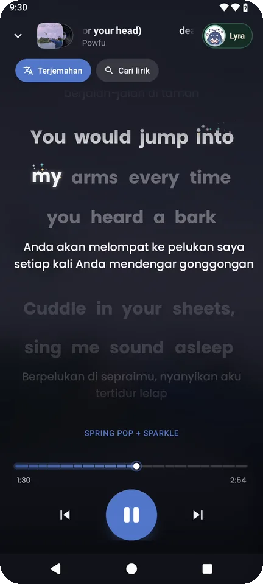
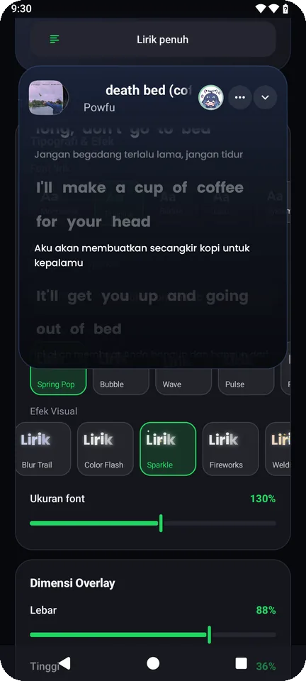
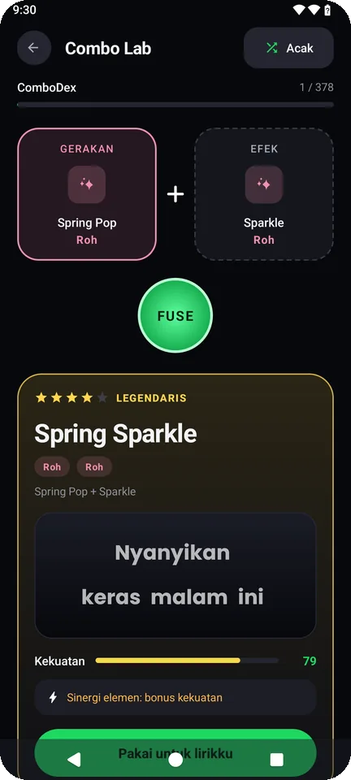

  

Rilis besar pertama sejak v16.3: 183 perubahan. Lirik kini datang dari enam sumber sekaligus, ada mode layar
penuh, Combo Lab untuk mencoba gaya animasi, dan Lyra, asisten AI yang bisa membaca dan memperbaiki lirik yang
sedang tampil, kini berwajah DeepSeek-chan.

  
  &nbsp;
  

<i>death bed</i> (Powfu), bagian rap, gaya Spring Pop + Sparkle, terjemahan Indonesia di bawah tiap baris.

## Yang baru

**Lirik lebih sering ketemu, dan lebih sering kata per kata**
- Enam sumber dicari bersamaan: Spicy Lyrics, Better Lyrics (Apple Music), LyricsPlus, Kugou, Netease, LRCLIB.
  Yang punya timing kata per kata dipakai lebih dulu, lalu per baris, lalu teks biasa.
- Format baru yang bisa dibaca: TTML, QRC, KRC, Enhanced LRC.
- Vokal latar tampil di baris kecilnya sendiri di bawah vokal utama.
- Lirik bisa dicari ulang dari aplikasi, atau ditempel sendiri kalau semua sumber salah.

**Layar penuh dan overlay yang dirombak**
- Mode layar penuh baru: sampul album keluar dari sampulnya seperti piringan hitam, warna latar mengikuti sampul,
  dengan tombol putar, lewati, dan bar posisi.
- Overlay didesain ulang, bisa diubah ukurannya, dan punya pintasan geser dari tepi layar.
- Ketuk baris mana pun untuk melompat ke bagian itu.

**Gaya animasi**
- 18 gerakan × 21 efek, dengan efek baru Aurora, Meteor Shower, Ring Pulse, Hologram, Sakura, dan empat efek
  gabungan: Supernova, Cosmic Sky, Inferno, Cyberpunk.
- Combo Lab: gabungkan satu gerakan dan satu efek, lihat nama, kelangkaan dan kekuatannya, lalu kumpulkan di
  ComboDex (378 kombinasi).

  
  &nbsp;
  
  &nbsp;
  

**Lyra, asisten lirik**
- Bisa melihat lagu dan lirik yang sedang tampil, lalu menjelaskan arti, menerjemahkan, membuat bacaan Latin
  (romaji, pinyin, romaja) per suku kata, memperbaiki kata atau timing, dan mengendalikan pemutar. Semua
  perubahannya bisa dibatalkan.
- Penyedia AI bisa dipilih: Google Antigravity, ChatGPT (Codex), atau API yang kompatibel dengan OpenAI. Ada
  input suara dan pencarian web.
- Wajahnya kini DeepSeek-chan, dengan ekspresi bergerak saat berpikir.

**Perbaikan**
- Lirik Jepang dan CJK tidak lagi terpotong atau terpisah-pisah, dan romaji sejajar dengan suku katanya.
- Efek seperti Sparkle, Welding dan Burning menempel di tepi bagian yang sudah dinyanyikan, apa pun gerakannya.
- Dua profil AI yang disimpan berurutan tidak lagi saling menimpa.

## Pasang

Unduh `LyricSync-v16.4.31.apk` di bawah. Bisa langsung menimpa versi sebelumnya; pengaturan dan cache lirik
tetap ada. Butuh Android 8.0 atau lebih baru.

APK rilis ini diminifikasi dengan R8 (sekitar 5 MB, separuh ukuran versi debug).

**Full Changelog**: https://github.com/Anniqa/LyricSync/compare/v16.3...v16.4.31
