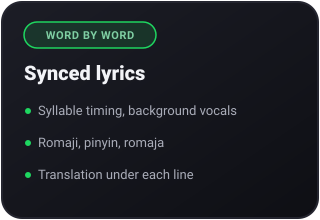
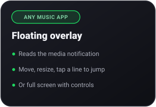
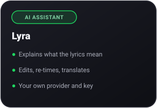

<p align="center">
  <picture>
    <source media="(prefers-color-scheme: light)" srcset=".github/readme/hero-light.webp">
    <source media="(prefers-color-scheme: dark)" srcset=".github/readme/hero-dark.webp">
    
  </picture>
</p>

<h1 align="center">LyricSync</h1>
<p align="center"><b>Synced lyrics floating over any music app on Android, highlighted word by word</b></p>

<p align="center">
  <a href="../../releases/latest"></a>
  
  <a href="LICENSE"></a>
  
</p>

<p align="center">
  LyricSync reads the song from the player's media notification (Spotify, YouTube Music and others),<br>
  finds its lyrics and shows them in a movable overlay or full screen.
</p>

<p align="center">
  <a href="#install"><b>Install</b></a>
  &nbsp;·&nbsp;
  <a href="#preview"><b>Preview</b></a>
  &nbsp;·&nbsp;
  <a href="#features"><b>Features</b></a>
  &nbsp;·&nbsp;
  <a href="#lyrics-sources"><b>Lyrics sources</b></a>
  &nbsp;·&nbsp;
  <a href="#lyra-ai"><b>Lyra AI</b></a>
  &nbsp;·&nbsp;
  <a href="#build"><b>Build</b></a>
</p>

<br>

<a name="preview"></a>
<br><br>

<p align="center">
  
  &nbsp;&nbsp;
  
</p>

<p align="center"><b>death bed</b> by Powfu, the rap verses. Motion <b>Spring Pop</b>, effect <b>Sparkle</b>, Indonesian translation under each line.</p>
<p align="center">Left: full screen. Right: the overlay on top of the music player. Recorded on Android 14 with LyricSync 16.4.29.</p>

<br><br>

<a name="features"></a>
<br><br>

<p align="center">
  
  &nbsp;
  
  &nbsp;
  
</p>

- Word and syllable highlighting, with romaji, pinyin or romaja for non-Latin lyrics
- Translation under each line (Google Translate or AI)
- Motion and effect styles you can mix, plus a Combo Lab
- Playback controls, seek bar and tap-a-line-to-jump
- Lyra, an AI assistant that explains lyrics and can edit, re-time or translate them for you
- English and Bahasa Indonesia

<br><br>

<a name="styles"></a>
<br><br>

Every lyric style is one **motion** (how a word moves when it is sung) combined with one **effect** (what is drawn
on it). Pick both in **Appearance → Lyrics animation**, or try pairs in the **Combo Lab**.

| | Styles |
|---|---|
| **Motion** (18) | Spring Pop, Bubble, Wave, Pulse, Rise, Typewriter, Drop, Zoom, Swing, Scatter, Calm, Classic, Bounce Drop, Elastic Pop, Heartbeat, Spin Settle, Squash-Stretch, Scatter Pop |
| **Effect** (21) | None, Neon Glow, Echo, Shimmer, Neon Flicker, Outline Pop, Blur Trail, Color Flash, Sparkle, Fireworks, Welding, Burning, Aurora, Meteor Shower, Ring Pulse, Hologram, Sakura, and four combinations: Supernova, Cosmic Sky, Inferno, Cyberpunk |

The preview above is **Spring Pop + Sparkle**: each word springs up as it is sung, and small glints pop along the
sung part of the word, drift upward and fade.

<br><br>

<a name="install"></a>
<br><br>

1. Download the APK from [Releases](../../releases) and install it.
2. Grant **Notification Access** and **Display Over Apps**.
3. Tap **Start Overlay** and play a song.

Requires Android 8.0 or later.

<br><br>

<a name="lyrics-sources"></a>
<br><br>

LyricSync asks several sources and keeps the best match: word-by-word timing first, then line-synced, then plain
text.

| Source | Timing |
|---|---|
| Spicy Lyrics | Word by word (needs a free key, below) |
| Better Lyrics | Apple Music TTML (syllables, background vocals, duets), QQ Music |
| LyricsPlus | Apple Music, QQ, Musixmatch, Deezer |
| Kugou | Word by word (KRC), strong on Asian and Indonesian music |
| Netease | Word by word (YRC) or line-synced |
| LRCLIB | Line-synced, open community lyrics |

<details>
<summary><b>Lyrics key (recommended)</b></summary>

Word-by-word lyrics from Spicy Lyrics need a free key:

1. Open [developers.spicylyrics.org](https://developers.spicylyrics.org/) and sign in.
2. Create an app and copy its publishable key (`sl_pk_…`).
3. In LyricSync, open **Syllable Lyrics API → Set key** and paste it.

Without a key, lyrics still come from Better Lyrics, LyricsPlus, Kugou, Netease and LRCLIB.

</details>

<br><br>

<a name="lyra-ai"></a>
<br><br>

Lyra and AI translation need one AI provider, set in the app:

| Provider | Sign-in |
|---|---|
| Google Antigravity | Sign in with Google |
| ChatGPT (Codex) | Sign in with your ChatGPT account |
| Any OpenAI-compatible API | Base URL and API key |

Web search for Lyra uses an [Exa](https://dashboard.exa.ai) API key.

Keys stay on your device. None are included in the app or this repository.

<br><br>

<a name="build"></a>
<br><br>

```sh
./gradlew testDebugUnitTest lintDebug assembleDebug
```

To build in a Spicy Lyrics key, put `spicy.client.key=sl_pk_…` in `local.properties`, or set the `SPICY_CLIENT_KEY`
environment variable. On GitHub Actions, add it as a repository secret.

GitHub Actions tests and builds every push. A `v*` tag publishes a release APK.

<br><br>

<a name="license"></a>
<br><br>

[GPL-3.0](LICENSE). LyricSync is not affiliated with Spotify or with any lyrics provider.
Lyra's face uses DeepSeek-chan chibi stickers from the community archive
[lmy414/ai-girl-stickers](https://github.com/lmy414/ai-girl-stickers), marked CC0 by their submitters. DeepSeek-chan is a
fan character, not an official DeepSeek mascot, and LyricSync is not affiliated with DeepSeek. To have an image credited or
removed, open an issue.
The song in the preview, *death bed (coffee for your head)*, belongs to Powfu; it is shown only to demonstrate the
lyric display.
