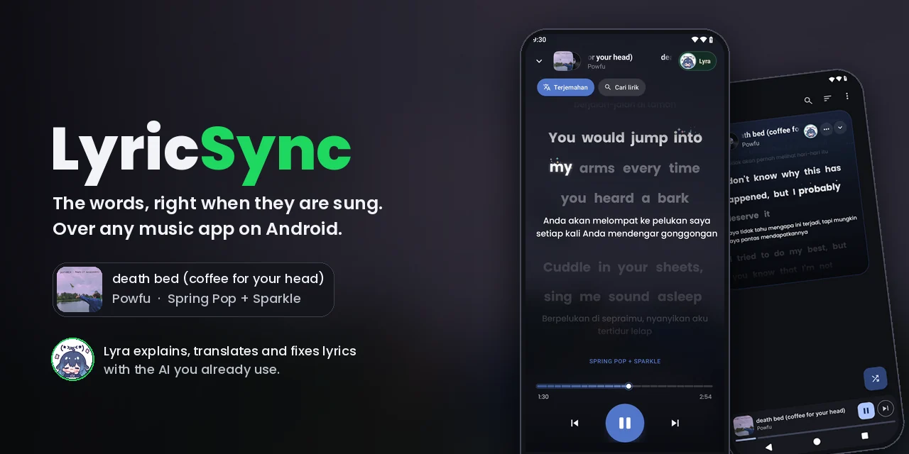
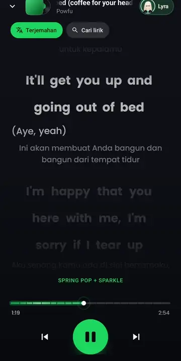
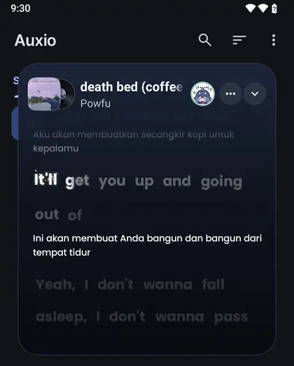
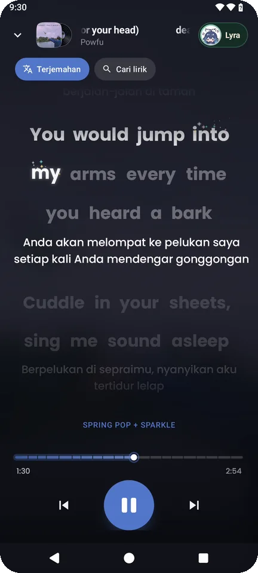
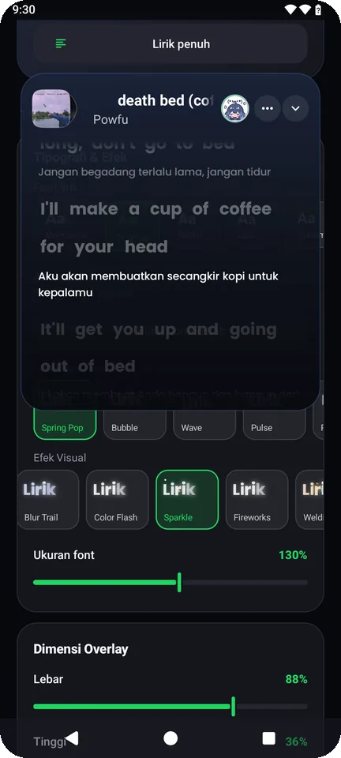
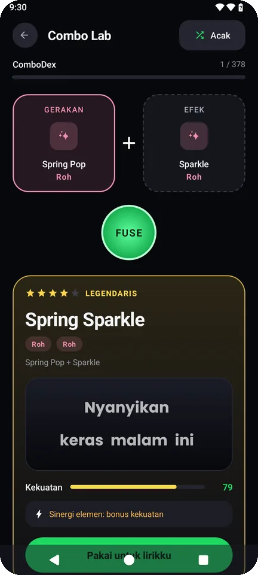

<p align="center">
  <picture>
    <source media="(prefers-color-scheme: light)" srcset=".github/readme/hero-light.webp">
    <source media="(prefers-color-scheme: dark)" srcset=".github/readme/hero-dark.webp">
    
  </picture>
</p>

<p align="center">
  <a href="../../releases/latest"></a>
  
  <a href="LICENSE"></a>
</p>

# LyricSync

LyricSync puts the lyrics of whatever you are playing on top of your screen and lights them up word by word, in
time with the music. It works with the player you already use. There is no account to make, nothing to import and
no new music app to learn: start a song in Spotify, YouTube Music or any other player, and the words appear.

<p align="center">
  
  &nbsp;&nbsp;
  
</p>

<p align="center"><i>death bed</i> by Powfu, both rap verses, with the Spring Pop motion and the Sparkle effect.<br>
Left: full screen. Right: the overlay floating over the player. Indonesian translation under each line.</p>

## Why LyricSync

Most players show lyrics one line at a time, if they show them at all, and only inside their own app. That falls
apart in the places where lyrics matter most:

- **Fast verses.** In a rap like the one above, a whole line goes by in two or three seconds. A highlighted line
  tells you roughly where the singer is. A highlighted word tells you exactly where.
- **Songs in a language you do not read.** Japanese, Korean or Chinese lyrics get a Latin reading lined up with
  each syllable, and a translation under each line, so you can sing along and understand it at the same time.
- **Doing something else.** The overlay floats over any app: a game, a chat, the browser. You do not have to keep
  the player open to follow the song.
- **Lyrics that are wrong or missing.** Instead of one source, LyricSync asks six and keeps the best timing it finds.
  When they are all wrong, you can paste your own, or ask Lyra to fix the timing for you.

## What it does

### Lyrics that follow the singer

The song is read from your player's media session, the same thing your lock screen uses, so LyricSync knows the
title, the artist, the cover and the exact playback position without touching the player. Lines are highlighted
word by word, and syllable by syllable when the source has that timing. Background vocals get their own smaller
line under the lead. During instrumental breaks, a row of dots counts down to the next line.

Tap any line to jump the song there. Play, pause, skip and a seek bar are in the overlay and in full screen.

### Two ways to read

<p align="center">
  
  &nbsp;
  
</p>

**The overlay** is a small window you can drag anywhere and resize. It stays above other apps and gets out of the
way when you collapse it. **Full screen** gives the lyrics the whole display, with the album cover spinning out of
its sleeve and its colours tinting the background.

Both can show the original lyrics, a Latin reading for non-Latin scripts (romaji, pinyin, romaja) and a translation
underneath, each toggled on its own. Translation uses Google Translate, or your AI provider if you set one up.

### Make it yours

Every highlight is a **motion** (how a word moves when it is sung) combined with an **effect** (what is drawn on
it). There are 18 motions and 21 effects:

| | |
|---|---|
| **Motion** | Spring Pop, Bubble, Wave, Pulse, Rise, Typewriter, Drop, Zoom, Swing, Scatter, Calm, Classic, Bounce Drop, Elastic Pop, Heartbeat, Spin Settle, Squash-Stretch, Scatter Pop |
| **Effect** | None, Neon Glow, Echo, Shimmer, Neon Flicker, Outline Pop, Blur Trail, Color Flash, Sparkle, Fireworks, Welding, Burning, Aurora, Meteor Shower, Ring Pulse, Hologram, Sakura, Supernova, Cosmic Sky, Inferno, Cyberpunk |



The **Combo Lab** turns picking a style into a small game. Choose a motion and an effect, press Fuse, and the pair
becomes a named combination with a rarity, an element and a strength score, previewed on a sample lyric. Every
combination you find goes into your ComboDex, which has 378 entries to collect. The one in the preview, Spring Pop
with Sparkle, comes out as *Spring Sparkle*, rated Legendary.

Five lyric fonts are built in (Montserrat, Poppins, Barlow, Lato and your system font), with an adjustable size.

<br clear="right">

### Lyra, the lyrics assistant

Lyra is an AI assistant that lives next to the lyrics, with DeepSeek-chan as her face. She can see the song that is
playing and the lyrics on screen, and she can act on them, not just talk about them:

- explain what a line or the whole song means, and search the web for interviews and background
- translate the song, or write the Latin reading for each syllable
- find other versions of the lyrics, or load lyrics you paste in (TTML, QRC, KRC, LRC or plain text)
- fix wrong words or re-time lines, with every edit undoable
- change the display or control the player when you ask

Lyra uses an AI provider you choose. Nothing is built in and nothing is paid for on your behalf.

## Lyrics sources

LyricSync asks several sources and keeps the best result: word-by-word timing first, then line-synced, then plain
text. Results are cached on the phone, so a song you have played before loads instantly and works offline.

| Source | What it gives |
|---|---|
| Spicy Lyrics | Word-by-word timing. Needs a free key, see below. |
| Better Lyrics | Apple Music lyrics with syllable timing, background vocals and duets; QQ Music as a fallback |
| LyricsPlus | Apple Music, QQ Music, Musixmatch and Deezer timelines |
| Kugou | Word-by-word, with a large catalogue of Asian and Indonesian music |
| Netease | Word-by-word or line-synced |
| LRCLIB | Open, community-made line-synced lyrics |

<details>
<summary><b>Adding a Spicy Lyrics key (recommended)</b></summary>

1. Open [developers.spicylyrics.org](https://developers.spicylyrics.org/) and sign in.
2. Create an app and copy its publishable key (`sl_pk_…`).
3. In LyricSync, open **Syllable Lyrics API → Set key** and paste it.

Without a key, everything still works; lyrics come from the other five sources.

</details>

## Install

1. Download the APK from the [latest release](../../releases/latest) and install it.
2. Allow **Notification access**, so LyricSync can see what is playing.
3. Allow **Display over other apps**, so the overlay can float on top.
4. Tap **Start Overlay** and play a song.

Android 8.0 or later. The app is in English and Bahasa Indonesia.

## Setting up Lyra (optional)

Lyra and AI translation need one AI provider, chosen in the app:

| Provider | How you connect |
|---|---|
| Google Antigravity | Sign in with your Google account |
| ChatGPT (Codex) | Sign in with your ChatGPT account |
| Any OpenAI-compatible API | A base URL and an API key |

For Lyra's web search, add an [Exa](https://dashboard.exa.ai) API key.

## Your data

LyricSync has no account, no analytics and no ads. It talks only to the lyrics sources above, to Spotify's public
search (to match the song to the right track before asking for lyrics), to Google Translate when you turn translation
on, and to the AI provider you set up. Keys and sign-ins stay on your phone; none are included in the app or in this
repository.

## Building from source

```sh
./gradlew testDebugUnitTest lintDebug assembleDebug
```

To build a Spicy Lyrics key into the app, put `spicy.client.key=sl_pk_…` in `local.properties` or set the
`SPICY_CLIENT_KEY` environment variable (a repository secret on GitHub Actions).

GitHub Actions tests and builds every push. Pushing a `v*` tag builds the minified release APK and publishes it on
the Releases page. The repository variable `RUNNER` can point the jobs at a self-hosted runner label when GitHub's
own runners are unavailable.

## License and credits

LyricSync is free software under the [GPL-3.0](LICENSE). It is not affiliated with Spotify, YouTube, Apple, or any
lyrics provider.

Lyra's face uses DeepSeek-chan chibi stickers from the community archive
[lmy414/ai-girl-stickers](https://github.com/lmy414/ai-girl-stickers), marked CC0 by their submitters.
DeepSeek-chan is a fan character, not an official DeepSeek mascot, and LyricSync is not affiliated with DeepSeek.
To have an image credited or removed, open an issue.

The song in the previews, *death bed (coffee for your head)* by Powfu feat. beabadoobee, and its cover art belong to
their owners. They appear only to show how lyrics are displayed.
