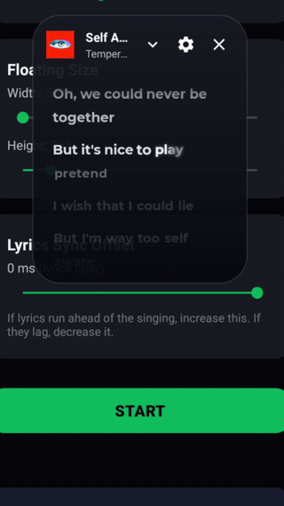

# LyricSync

Floating synced lyrics on top of whatever you're playing.

It reads what's playing from the media notification (Spotify, YT Music, etc.), pulls the lyrics, and shows them in a draggable overlay that highlights word-by-word as the song goes. Word-level timing comes from SpicyLyrics when the track has it, otherwise it falls back to line-synced lyrics from Netease or LRCLIB.

## Preview

<p align="center">
  
</p>

## What it does
- Word / syllable highlighting that follows the beat, with a smooth spring scroll
- **18 motion styles × 15 effects** — mix any motion (Spring Pop, Bubble, Wave, Typewriter, Elastic Pop, Heartbeat, Squash-Stretch, …) with any effect (Neon Glow, Aurora, Meteor Shower, Ring Pulse, Fireworks, Welding, Burning, …). Every style has its own signature (ghost trails, splashes, reflections, dust, caret, …) and is driven by the playback clock, so seeking never breaks an animation. Pick from the app (live previews) or straight from the overlay
- **Font picker** — Montserrat, Poppins, Barlow, Lato, or the system font, all bundled (OFL) so no downloads are needed
- Auto-syncs to the player position (no manual seeking) and self-corrects drift
- **Tap any line to jump the player there**
- **Playback controls** (previous / play-pause / next) right in the overlay
- **Colour picked from the album art** — the overlay and the app's now-playing card retint themselves each track
- Smooth at any refresh rate (60–144 Hz), re-fits itself on rotation, split screen and resize
- **Hideable header buttons** — tap the song title (or cover) to hide the controls so long titles show in full; tap again to bring them back
- Sync offset slider (±1500 ms, with ±10 ms fine-tune) if a song is still a touch early or late
- Album art, adjustable size and font scale
- Draggable anywhere on screen; position is remembered and stays on-screen
- **Lyrics translation** under each line — Google Translate, or Gemini (via Google Antigravity) for natural, poetic translations
- **AI Insights** — chat about the song (meaning, background, trivia) with optional Google web search grounding; pick the chat and search models yourself
- Material 3 app screen: dark, high-contrast (WCAG AA), English and Bahasa Indonesia
- Works over any music app that posts a media notification

## Setup
1. Install the APK
2. Grant **Notification access** (so it can see what's playing) and **Display over other apps**
3. Hit start, play a song, done
4. Optional: connect Google (Antigravity) in the AI card for AI translation and insights, or set your own Spicy Lyrics client key

Needs Android 8.0+.

## Build
Every push and pull request runs the unit tests, Android lint and a debug build on GitHub Actions; the APK is uploaded as the `LyricSync-debug` artifact (test and lint reports are uploaded too). Pushing a version tag (`v*`) builds the **minified release APK** (R8) and publishes it on the [Releases](../../releases) page. Locally:

```
./gradlew testDebugUnitTest lintDebug assembleDebug
```

Code map: `overlay/` (floating window, config, geometry, render loop), `renderer/` (word highlighter, motions and effects), `ui/main/` (app screen, one controller per card), `lyrics/` (providers), `ai/` (Antigravity client and tools).

Lyrics come from SpicyLyrics, Netease and LRCLIB. Not affiliated with any of them, or with Spotify.
